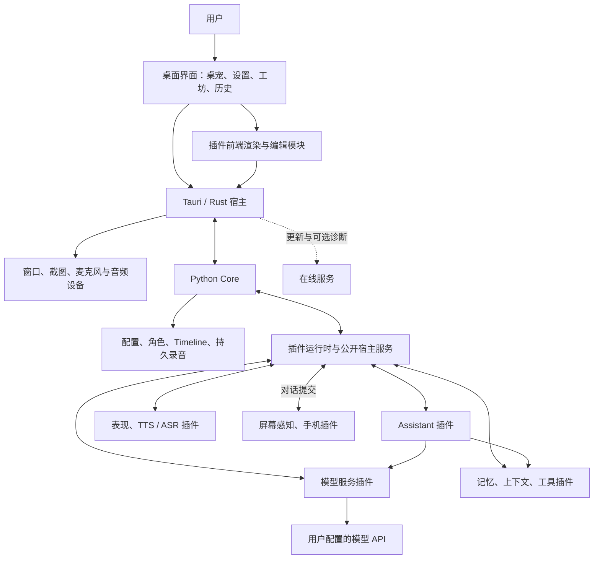
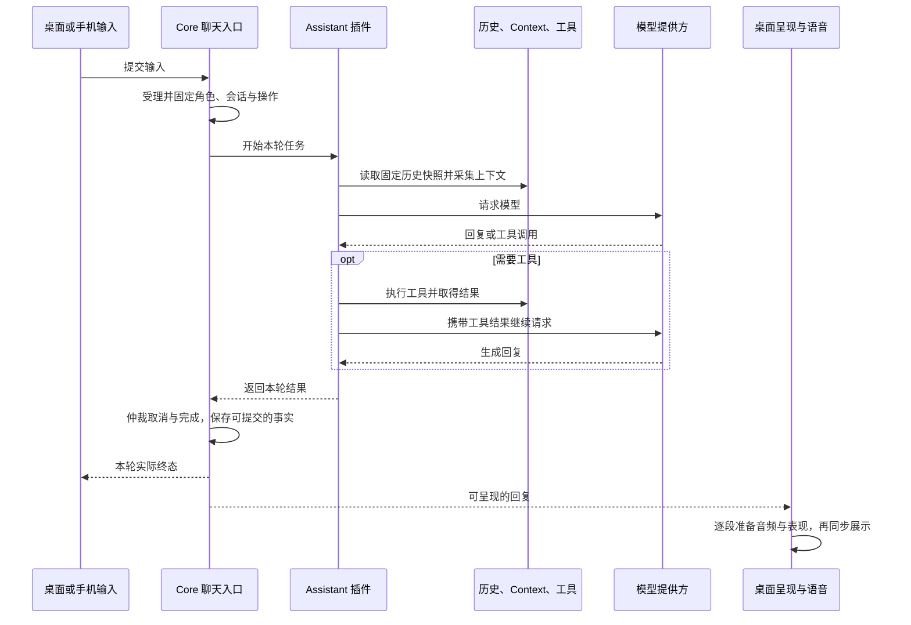

# 架构与模块关系

Sakura 由桌面宿主、Core、插件和在线服务组成。桌面宿主提供系统能力，Core 管理共享数据与操作受理，插件实现可替换的业务能力，在线服务提供发布资料和可选诊断。

本页说明模块如何协作。每个模块的职责、流程、数据与失败行为在 [Spec](../specs/README.md) 中维护；选择这些边界的理由在 [ADR](../adr/README.md) 中维护。

## 运行结构

Core 与各插件使用独立进程。图中的插件调用通过服务路由完成，不共享 Python 对象或私有实现。前端模块来自已安装插件，在宿主 WebView 中执行；它与 Python 插件进程的隔离能力不同。

在线服务不是本地运行的前提。它不可用时，本地设置、角色和已安装功能仍可使用；模型请求是否联网取决于所选提供方。

## 模块目录

| 模块 | 主要责任 | 主要代码入口 | Spec |
|---|---|---|---|
| 桌面运行时 | Core 生命周期、IPC、原生能力、进程回收 | `desktop/src-tauri/`、`app/core_host/` | [运行时](../specs/desktop-runtime.md) |
| 插件运行时 | 安装、独立依赖、服务路由、贡献和实例生命周期 | `app/plugins/`、`app/plugin_sdk/` | [插件](../specs/plugin-runtime.md) |
| 设置 | 配置归属、页面贡献、草稿、保存与应用 | `desktop/frontend/settings/`、`app/core_host/plugin_settings.py` | [设置](../specs/settings.md) |
| 对话与 Assistant | 统一受理、模型工具循环、取消和最终提交 | `app/core_host/real_chat.py`、`plugins/builtin/sakura_assistant/` | [对话](../specs/conversation.md) |
| 模型服务 | 连接凭据、模型目录、选择槽和实际请求 | `app/core_host/provider_settings.py`、`plugins/builtin/sakura_model_openai_compatible/` | [模型](../specs/model-services.md) |
| 历史与记忆 | 已发生的对话事实、轮次读取、记忆整理与召回 | `app/storage/`、`plugins/optional/sakura_mem0/` | [历史与记忆](../specs/timeline-memory.md) |
| 角色与工坊 | 角色身份、资源、草稿、导入导出和局部更新 | `app/core_host/character_studio.py`、`desktop/frontend/studio/` | [角色](../specs/characters.md) |
| 窗口与表现 | 可见范围、命中、表现控制和段落呈现 | `desktop/frontend/pet/`、`app/core_host/visual_host.py`、`desktop/src-tauri/` | [窗口与表现](../specs/window-presentation.md) |
| 语音 | 录音采集、识别、合成、播放和历史留存 | `app/core_host/asr_boundary.py`、`app/core_host/tts_boundary.py`、TTS / ASR Hub | [语音](../specs/voice.md) |
| SakuraTTS | 整合包、推理进程、模型预加载与本地合成 | `plugins/builtin/sakura_sakuratts/` | [SakuraTTS](../specs/sakuratts.md) |
| 屏幕感知 | 手动截图、定时观察、主动互动和截图消费 | `app/core_host/screen_host.py`、`plugins/builtin/sakura_screen_awareness/` | [屏幕感知](../specs/screen-awareness.md) |
| 工具与 MCP | 工具登记执行、MCP 连接、联网和浏览器能力 | `app/core_host/tools.py`、`plugins/builtin/sakura_mcp/` | [工具与 MCP](../specs/tools-mcp.md) |
| 诊断 | 操作日志、原始错误、Trace 与远程报告 | `desktop/src-tauri/src/runtime_log.rs`、`app/core_host/runtime_logging.py` | [诊断](../specs/diagnostics.md) |
| 发行与存储 | 程序交付、用户数据保留、更新与迁移 | `tools/release/`、`app/legacy_import/` | [发行与存储](../specs/release-storage.md) |
| 在线服务 | 公开发布资料、私人控制台、诊断接收与官网 | `services/sakura/` | [在线服务](../specs/services.md) |

同类能力的提供方共用一份模块规格，插件自身的配置与特殊资源约定保留在所属 README。SakuraTTS 还需管理整合包安装和推理进程，因此另有模块规格。

## 一次对话如何经过各模块

Core 的正文提交与桌面播放是不同完成点。前者确认对话结果是否已保存，后者确认某段内容是否实际展示或播放。没有回复的主动观察可以正常结束；不能据此伪造一条助手回复。

主动屏幕感知通过宿主截图取得本会话资源，再使用相同的对话受理入口。语音输入先把识别文字放回草稿，由用户发送。设置测试连接使用独立探测能力，不创建聊天记录。

## 数据与资源由谁管理

| 对象 | 主要拥有者 | 其他模块如何使用 |
|---|---|---|
| 角色包与工坊草稿 | Core 的角色与工坊服务 | 插件只解释所属资源；宿主负责发布和归档 |
| 本机角色选择与语音偏好 | 相应宿主配置或 Hub | 导入角色资源不覆盖设备使用选择 |
| 连接密钥 | 模型提供方 | 消费者取得模型引用，不复制凭据 |
| Timeline | Core | Assistant 和插件按授权只读，不另建聊天事实库 |
| 长期记忆与便签 | 所属记忆插件 | 通过 Context、工具与设置参与业务 |
| 合成任务与推理进程 | 语音 Provider | Hub 转交任务，Core 接收结果 |
| 持久录音与临时音频副本 | Core 与各自接收者 | 桌面播放和远程传输不删除原录音 |
| 原生窗口、设备与整棵进程树 | Shell | 前端与 Core 通过现有宿主接口请求 |
| 插件配置及私有数据 | 插件 | 设置页组织展示，安装更新保留数据 |
| 公开版本资料和诊断库 | 在线服务的对应管理者 | 客户端读取发布结果或按开关发送诊断 |

各层只校验自己拥有的格式与边界，避免重复限制。模块之间的可变状态通过请求快照、角色身份和实例身份隔离，不依赖读取另一模块的内部对象。

## 设置、切换和失败的协作

- 保存字段后由其拥有者应用，界面分别展示保存和应用结果；无关插件与草稿不被重建。
- 切换角色先退役旧会话与授权，再建立新会话；模型和引擎等可复用资源继续运行。
- 插件停用或重载撤销服务及贡献，旧绑定不能自动改指向同 ID 的新实例。
- Core 失败时保留界面与原始原因，清理旧资源，由用户明确重试；结果未知的模型、工具和写操作不自动重放。
- 可选资源或诊断失败按所属步骤报告，不改变其他已经完成的业务结果。

这些取舍分别见[生命周期](../adr/explicit-lifecycle.md)、[配置归属](../adr/settings-ownership.md)、[资源所有权](../adr/media-resource-ownership.md)与[校验责任](../adr/validation-ownership.md)。

## 修改模块时的阅读入口

先读对应 Spec 的职责和上下游，再看关联 ADR 与公开接口。涉及新提供方时读 [Plugin SDK](plugin-sdk.md)和[能力接入](plugin-recipes.md)；涉及角色资源读[角色接口](characters.md)；涉及交付或服务部署读[发行](release.md)与[服务运维](services.md)。

代码目录定位实现，Spec 定义业务结果，ADR 说明边界理由。验证选择能发现相应业务错误的现有测试，入口见 [Harness](../../harness/README.md)；协作规则见 [AGENTS.md](../../AGENTS.md)。
